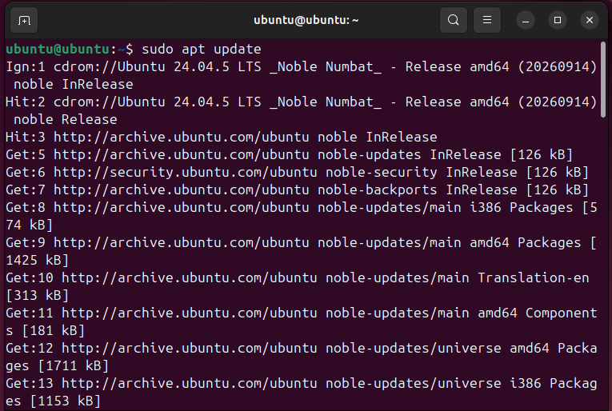
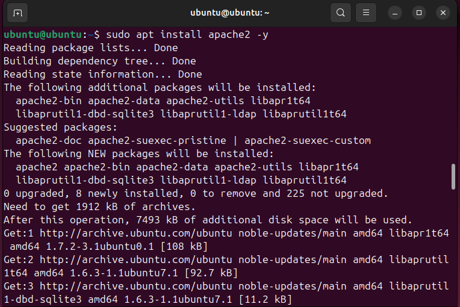
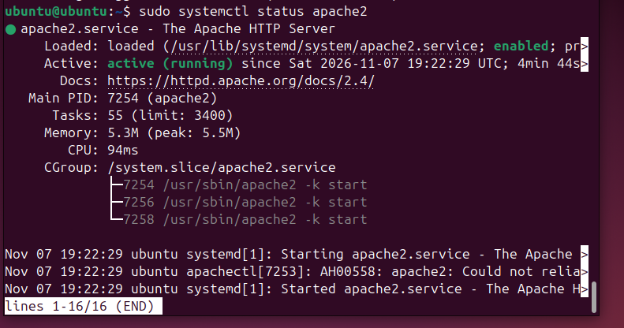
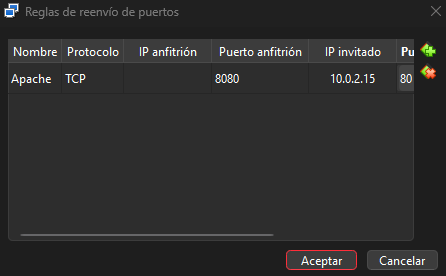
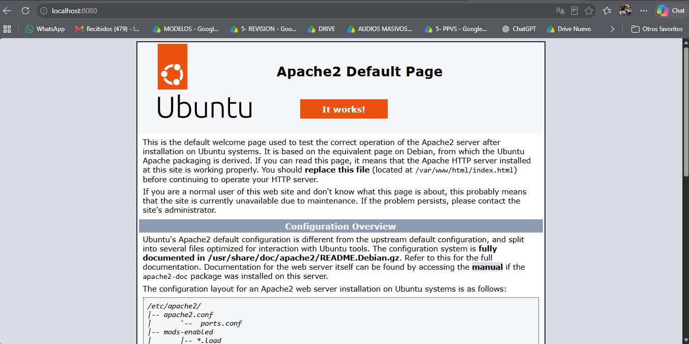

# Implementación de un servidor web virtualizado

## Descripción del proyecto

Este proyecto consiste en la implementación de un servidor web virtualizado mediante Oracle VirtualBox y Ubuntu 24.04.5.1 LTS, realizado como trabajo práctico de la materia Arquitectura y Sistemas Operativos de la Tecnicatura Universitaria en Programación de la UTN.

El objetivo fue crear una máquina virtual e instalar un servidor web Apache, comprobando su funcionamiento tanto desde Ubuntu como desde el sistema anfitrión Windows 11.

## Herramientas utilizadas
- Windows 11 (sistema anfitrión).
- Oracle VirtualBox 7.2.2.
- Ubuntu 24.04.5.1 LTS (sistema invitado).
- Apache HTTP Server.
- Navegadores web para realizar las pruebas de acceso.

## Implementación

El proceso se desarrolló en las siguientes etapas:
- Creación y configuración de una máquina virtual en Oracle VirtualBox.
- Asignación de 4096 MB de memoria RAM, 1 procesador y un disco virtual de 25 GB.
- Instalación de Ubuntu 24.04.5.1 LTS como sistema operativo invitado.
- Actualización de los paquetes disponibles mediante la terminal.
- Instalación y verificación del servidor web Apache.
- Configuración de la red en modo NAT y del reenvío de puertos, utilizando el puerto 8080 del sistema anfitrión y el puerto 80 de la máquina virtual.
- Creación de una instantánea para conservar el estado alcanzado.

## Resultados obtenidos

Se logró instalar y ejecutar Apache correctamente dentro de Ubuntu. También se comprobó el acceso a la página predeterminada del servidor desde el navegador del sistema invitado y desde Windows 11, mediante la dirección http://localhost:8080.

La implementación permitió poner en práctica los conceptos de virtualización, administración de recursos y comunicación de red entre sistemas operativos.

## Evidencias de implementación

### 1. Máquina virtual creada

### 2. Actualización de Ubuntu

### 3. Instalación de Apache

### 4. Verificación del servicio Apache

### 5. Configuración del reenvío de puertos

### 6. Acceso al servidor desde Windows

## Documentación

El desarrollo completo, el marco teórico, la metodología, las pruebas y las conclusiones se encuentran en el siguiente documento:

[Trabajo Practico AYSO - Santillan Lucia](Trabajo%20Practico%20AYSO%20-%20Santillan%20Lucia.pdf)
